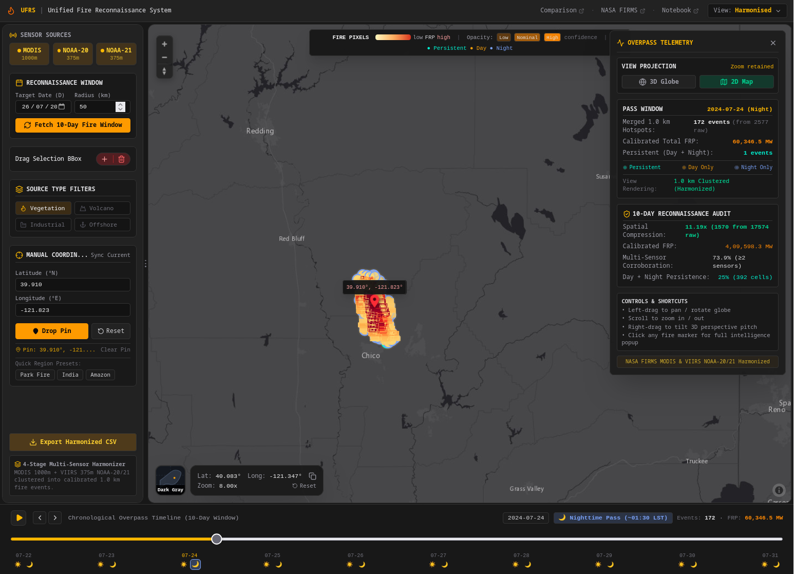

# UFRS

## Unified Fire Reconnaissance System

UFRS is an interactive wildfire map built for the NASA Space Apps Challenge. It combines fire detections from three satellite sources:

- MODIS from Terra and Aqua
- VIIRS from NOAA-20
- VIIRS from NOAA-21

**GitHub repository:** [github.com/TintedMage/UFRS](https://github.com/TintedMage/UFRS)

The app turns many overlapping satellite detections into a clearer set of fire events. This makes it easier to see where fires are happening, how strong they are, and whether they appear during both daytime and nighttime passes.

**Code-generation assistance:** Antigravity and GitHub Copilot.

## What the app shows

- A dark, interactive map with fire pixels and harmonized fire events
- Raw satellite pixel footprints
- Harmonized 1 km fire events
- Day and night filtering across a 10-day timeline
- Persistent, day-only, and night-only fire categories
- Fire Radiative Power (FRP) colors from low to high
- Confidence shown through opacity
- Sensor filters for MODIS, NOAA-20, and NOAA-21
- A draggable map pin and manual latitude/longitude controls
- Drag-and-drop bounding-box selection
- Telemetry showing event counts, FRP, persistence, and sensor agreement
- CSV export for harmonized events

## Screenshot

### Harmonised workspace



The working workspace includes the map, satellite controls, fire legend, telemetry panel, raw pixel layer, harmonized 1 km events, and chronological overpass timeline. The screenshot uses the cached Park Fire dataset.

## Quick start

### Requirements

- Python 3
- Node.js and npm
- A modern web browser

The application can run using the included cached data. A NASA FIRMS API key is only needed when downloading fresh data.

### 1. Start the backend

Open a terminal in the project folder:

```bash
cd ufrs-backend
python -m venv .venv
```

Activate the environment:

```bash
# macOS/Linux
source .venv/bin/activate

# Windows PowerShell
.venv\Scripts\Activate.ps1
```

Install the Python packages:

```bash
pip install -r requirements.txt
```

Optional: create `ufrs-backend/.env` for fresh NASA FIRMS downloads:

```env
FIRMS_MAP_KEY=your_nasa_firms_key
```

Start the API:

```bash
python main.py
```

The backend runs at `http://127.0.0.1:8000`.

### 2. Start the frontend

Open a second terminal:

```bash
cd ufrs-frontend
npm install
npm run dev
```

Open the address printed by Vite, normally:

```text
http://localhost:5173
```

Choose **Park Fire** in the left panel to load the included cached example data.

## Using the map

1. Choose a quick region such as **Park Fire**, **India**, or **Amazon**.
2. Select the target date and click **Fetch 10-Day Fire Window**.
3. Use the timeline at the bottom to move between daytime and nighttime satellite passes.
4. Toggle MODIS, NOAA-20, or NOAA-21 to compare sensor coverage.
5. Use the map legend:
   - Yellow to red means lower to higher FRP.
   - More opacity means higher confidence.
   - Cyan means persistent across day and night.
   - Orange means day-only.
   - Blue means night-only.
6. Drag the red map pin to move the analysis location.
7. Turn on **Drag Selection BBox** to draw a custom area on the map.
8. Use **Export Harmonized CSV** to download the current harmonized results.

The top bar also includes links to the NASA FIRMS source documentation and the original research notebook.

## How the data is organized

The backend follows four simple steps:

1. Download or read fire detections from NASA FIRMS.
2. Assign detections to a local solar fire day.
3. Match nearby detections from different sensors.
4. Return raw pixels and deduplicated harmonized events to the map.

Harmonized events include their location, calibrated FRP, persistence category, confidence, contributing sensors, and the number of raw detections merged into the event.

Cached responses are stored in:

```text
ufrs-backend/data/cache/
```

The cache allows the demo to load without waiting for a new NASA FIRMS request.

## Project layout

```text
UFRS/
├── README.md
├── render.yaml
├── ufrs-backend/
│   ├── main.py
│   ├── services/
│   │   └── harmonizer.py
│   ├── data/cache/
│   └── requirements.txt
└── ufrs-frontend/
    ├── src/
    │   ├── components/
    │   └── stores/
    ├── public/
    ├── package.json
    └── vercel.json
```

## Deployment

### Backend on Render

Use the included [`render.yaml`](./render.yaml), or enter these settings manually:

```text
Root directory: ufrs-backend
Build command: pip install -r requirements.txt
Start command: uvicorn main:app --host 0.0.0.0 --port $PORT --workers 1
```

Add `FIRMS_MAP_KEY` as a Render environment variable. Do not commit `.env` or the API key.

Render's free service may sleep after inactivity and has an ephemeral filesystem. Keep the included cache files in the repository so the demo can start with sample data after a restart.

### Frontend on Vercel

Set the project root to `ufrs-frontend`. Vercel detects Vite automatically. Add this environment variable:

```text
VITE_API_BASE_URL=https://your-backend.onrender.com
```

The frontend uses that value for production API requests. During local development, it uses the Vite proxy.

## Useful commands

From `ufrs-frontend`:

```bash
npm run dev
npm run build
npm run lint
```

From `ufrs-backend`:

```bash
python main.py
```

Health check:

```text
http://127.0.0.1:8000/api/health
```

## Related project files

- [Research notebook](./ufrs-frontend/public/NASASpaceApps2026_Sygnition%283%29.ipynb)
- [Frontend documentation](./ufrs-frontend/README.md)
- [Backend deployment configuration](./render.yaml)
